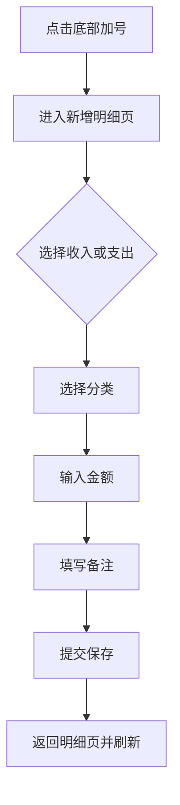
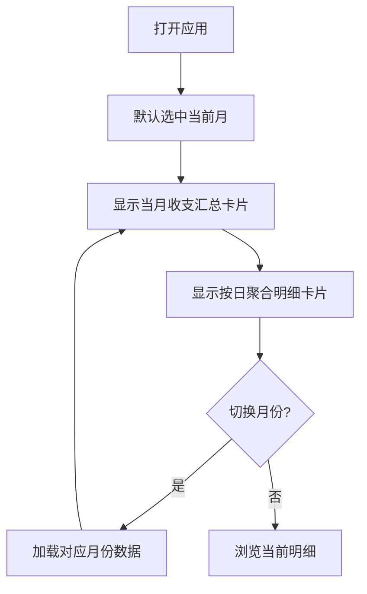

# 记账应用 PRD

## 1. 产品概述
一款面向移动端 H5 的个人记账应用，帮助用户便捷记录日常收支、追踪加油开销并通过图表直观了解消费结构。
- 解决用户随手记账、按月汇总、分类分析的需求
- 目标用户为有日常记账和用车开销管理需求的个人用户

## 2. 核心功能

### 2.1 功能模块
1. **明细页（首页）**：月份选择器、当月收支汇总卡片、按日聚合的收支明细卡片
2. **图表页**：按分类统计支出占比、收支趋势分析
3. **新增明细页**：收支类型选择 → 分类选择 → 金额输入 → 备注填写
4. **汽油页**：加油记录列表、油费统计汇总
5. **我的页**：应用信息、数据统计概览

### 2.2 页面详情
| 页面名称 | 模块名称 | 功能描述 |
|---------|---------|---------|
| 明细页 | 月份选择器 | 左右切换月份，默认当前月，显示选中月份 |
| 明细页 | 收支汇总卡片 | 显示当月总收入、总支出、结余 |
| 明细页 | 按日明细卡片 | 按天聚合展示当月每笔收支，含日期、分类、金额、备注 |
| 图表页 | 分类饼图 | 按支出分类展示占比 |
| 图表页 | 趋势柱状图 | 按日展示当月收支趋势 |
| 新增明细页 | 类型选择 | 切换收入/支出 |
| 新增明细页 | 分类选择 | 网格图标选择分类 |
| 新增明细页 | 金额输入 | 数字键盘输入金额 |
| 新增明细页 | 备注输入 | 文本输入备注 |
| 汽油页 | 油费汇总 | 显示总加油次数、总油费、平均单价 |
| 汽油页 | 加油记录列表 | 按时间倒序展示加油记录 |
| 我的页 | 统计概览 | 总记账笔数、总支出、总收入 |
| 我的页 | 应用信息 | 版本号等信息 |

## 3. 核心流程

### 3.1 新增记账流程
用户点击底部加号 → 进入新增页 → 选择收入或支出 → 选择分类 → 输入金额 → 填写备注（可选）→ 提交保存 → 返回明细页刷新列表

### 3.2 浏览明细流程
打开应用 → 默认显示当前月 → 查看收支汇总 → 滚动查看按日聚合明细 → 左右切换查看其他月份

## 4. 界面设计

### 4.1 设计风格
- **主色调**：墨黑 `#1A1A1A` 为文字与主要元素色，暖白 `#FAFAF7` 为背景
- **强调色**：琥珀金 `#D97706` 用于加号按钮和高亮强调
- **收支色**：收入用翠绿 `#16A34A`，支出用珊瑚红 `#EF4444`
- **按钮风格**：圆角胶囊按钮，加号为悬浮凸起圆形大按钮
- **字体**：标题使用思源黑体粗体，正文使用系统默认无衬线字体
- **布局**：移动端卡片式布局，底部固定导航栏，顶部粘性月份选择器
- **图标风格**：线性简洁图标（lucide-react），分类使用彩色圆形背景图标

### 4.2 页面设计概览
| 页面名称 | 模块名称 | UI 元素 |
|---------|---------|---------|
| 明细页 | 月份选择器 | 粘性顶部，左右箭头切换，居中显示年月 |
| 明细页 | 收支汇总卡片 | 白色圆角卡片，三列布局显示收入/支出/结余 |
| 明细页 | 按日明细卡片 | 白色圆角卡片，按日期分组，每行含分类图标、备注、金额 |
| 图表页 | 饼图区域 | 环形图展示分类占比，图例标注百分比 |
| 图表页 | 趋势图区域 | 柱状图展示每日收支 |
| 新增明细页 | 类型切换 | 顶部两个胶囊按钮切换收入/支出 |
| 新增明细页 | 分类网格 | 4列网格图标，选中高亮 |
| 新增明细页 | 金额输入 | 大字号金额显示，底部数字键盘 |
| 汽油页 | 统计卡片 | 三列汇总数据 |
| 汽油页 | 记录列表 | 卡片式加油记录 |
| 我的页 | 概览卡片 | 统计数据展示 |

### 4.3 响应式设计
- 移动端优先（Mobile-First），最大宽度 480px 居中显示
- 触摸优化：按钮最小点击区域 44px，底部导航栏适配安全区域
- 桌面端访问时居中显示移动端布局，两侧留白
