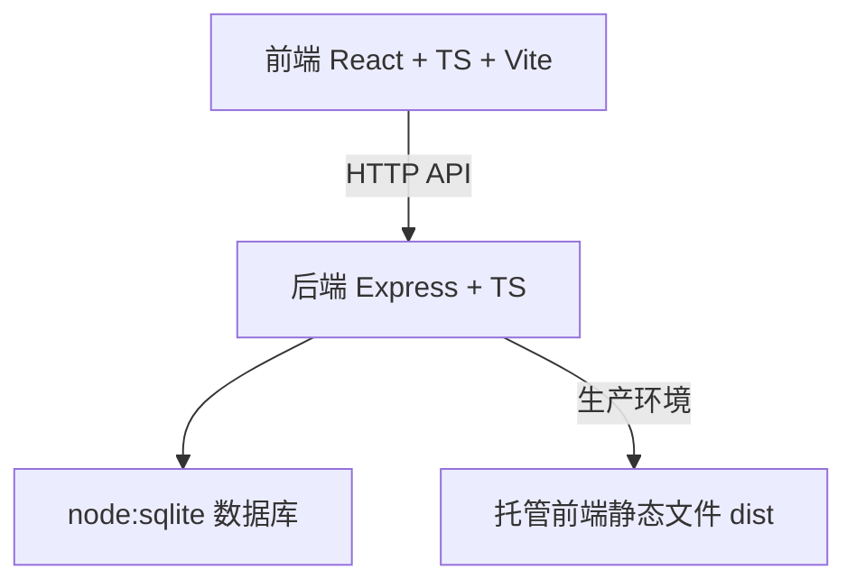
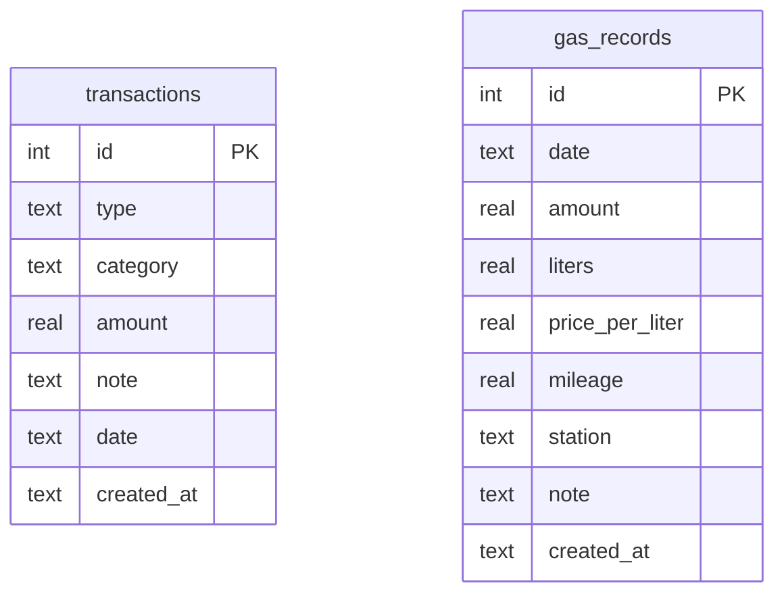

# 记账应用技术架构文档

## 1. 架构设计



开发环境：前端 Vite Dev Server（5173）与后端 Express Server（3000）分别启动，前端通过代理转发 API 请求。
生产环境：后端 Express 托管前端构建产物 `dist/` 静态文件，单一服务对外提供。

## 2. 技术说明
- **前端**：React 19 + TypeScript + Vite + Tailwind CSS 4 + Zustand + react-router-dom
- **初始化工具**：vite-init（react-express-ts 模板）
- **后端**：Express 5 + TypeScript（ESM 格式）
- **数据库**：node:sqlite（Node.js 内置 SQLite 模块）
- **图表**：recharts
- **图标**：lucide-react

## 3. 路由定义
| 路由 | 用途 |
|------|------|
| `/` | 明细页（首页），当月收支汇总与按日明细 |
| `/charts` | 图表页，分类占比与趋势分析 |
| `/add` | 新增明细页 |
| `/gas` | 汽油页，加油记录管理 |
| `/profile` | 我的页，统计概览 |

## 4. API 定义

### 4.1 类型定义
```typescript
// 收支类型
type TransactionType = 'income' | 'expense';

// 交易记录
interface Transaction {
  id: number;
  type: TransactionType;
  category: string;
  amount: number;
  note: string;
  date: string; // YYYY-MM-DD
  created_at: string;
}

// 加油记录
interface GasRecord {
  id: number;
  date: string;        // YYYY-MM-DD
  amount: number;      // 总金额
  liters: number;      // 升数
  price_per_liter: number; // 每升单价
  mileage: number;     // 里程数
  station: string;     // 加油站
  note: string;
  created_at: string;
}

// 月度汇总
interface MonthlySummary {
  income: number;
  expense: number;
  balance: number;
}

// 分类统计
interface CategoryStat {
  category: string;
  amount: number;
  percentage: number;
}
```

### 4.2 接口列表
| 方法 | 路径 | 说明 | 请求参数 | 响应 |
|------|------|------|---------|------|
| GET | `/api/transactions` | 获取月度交易列表 | `?month=YYYY-MM` | `Transaction[]` |
| POST | `/api/transactions` | 新增交易 | `Transaction` (无id) | `Transaction` |
| DELETE | `/api/transactions/:id` | 删除交易 | - | `{ success: boolean }` |
| GET | `/api/transactions/summary` | 获取月度汇总 | `?month=YYYY-MM` | `MonthlySummary` |
| GET | `/api/transactions/by-day` | 获取按日聚合明细 | `?month=YYYY-MM` | `DailyTransaction[]` |
| GET | `/api/charts/category` | 获取分类统计 | `?month=YYYY-MM&type=expense` | `CategoryStat[]` |
| GET | `/api/charts/trend` | 获取每日趋势 | `?month=YYYY-MM` | `DailyTrend[]` |
| GET | `/api/gas` | 获取加油记录 | - | `GasRecord[]` |
| POST | `/api/gas` | 新增加油记录 | `GasRecord` (无id) | `GasRecord` |
| GET | `/api/stats/overview` | 获取总览统计 | - | `{ count, income, expense }` |

## 5. 服务器架构


- **routes**：定义 API 路由，处理请求参数校验
- **services**：业务逻辑处理，数据查询与聚合
- **db**：SQLite 数据库连接与初始化

## 6. 数据模型

### 6.1 数据模型定义


### 6.2 数据定义语言
```sql
-- 交易记录表
CREATE TABLE IF NOT EXISTS transactions (
  id INTEGER PRIMARY KEY AUTOINCREMENT,
  type TEXT NOT NULL CHECK(type IN ('income', 'expense')),
  category TEXT NOT NULL,
  amount REAL NOT NULL,
  note TEXT DEFAULT '',
  date TEXT NOT NULL,
  created_at TEXT DEFAULT (datetime('now', 'localtime'))
);
CREATE INDEX IF NOT EXISTS idx_transactions_date ON transactions(date);
CREATE INDEX IF NOT EXISTS idx_transactions_type ON transactions(type);

-- 加油记录表
CREATE TABLE IF NOT EXISTS gas_records (
  id INTEGER PRIMARY KEY AUTOINCREMENT,
  date TEXT NOT NULL,
  amount REAL NOT NULL,
  liters REAL NOT NULL,
  price_per_liter REAL NOT NULL,
  mileage REAL DEFAULT 0,
  station TEXT DEFAULT '',
  note TEXT DEFAULT '',
  created_at TEXT DEFAULT (datetime('now', 'localtime'))
);
CREATE INDEX IF NOT EXISTS idx_gas_date ON gas_records(date);
```

### 6.3 分类预设数据
**支出分类**：餐饮、交通、购物、娱乐、居住、医疗、教育、通讯、其他
**收入分类**：工资、奖金、兼职、投资、红包、其他
